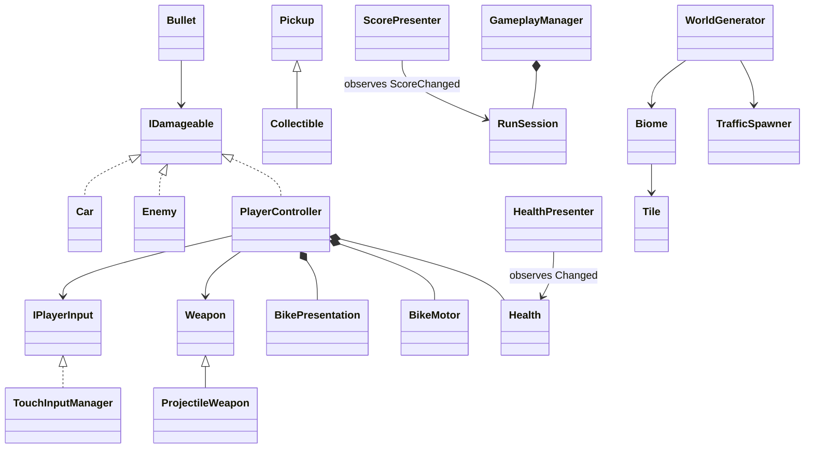
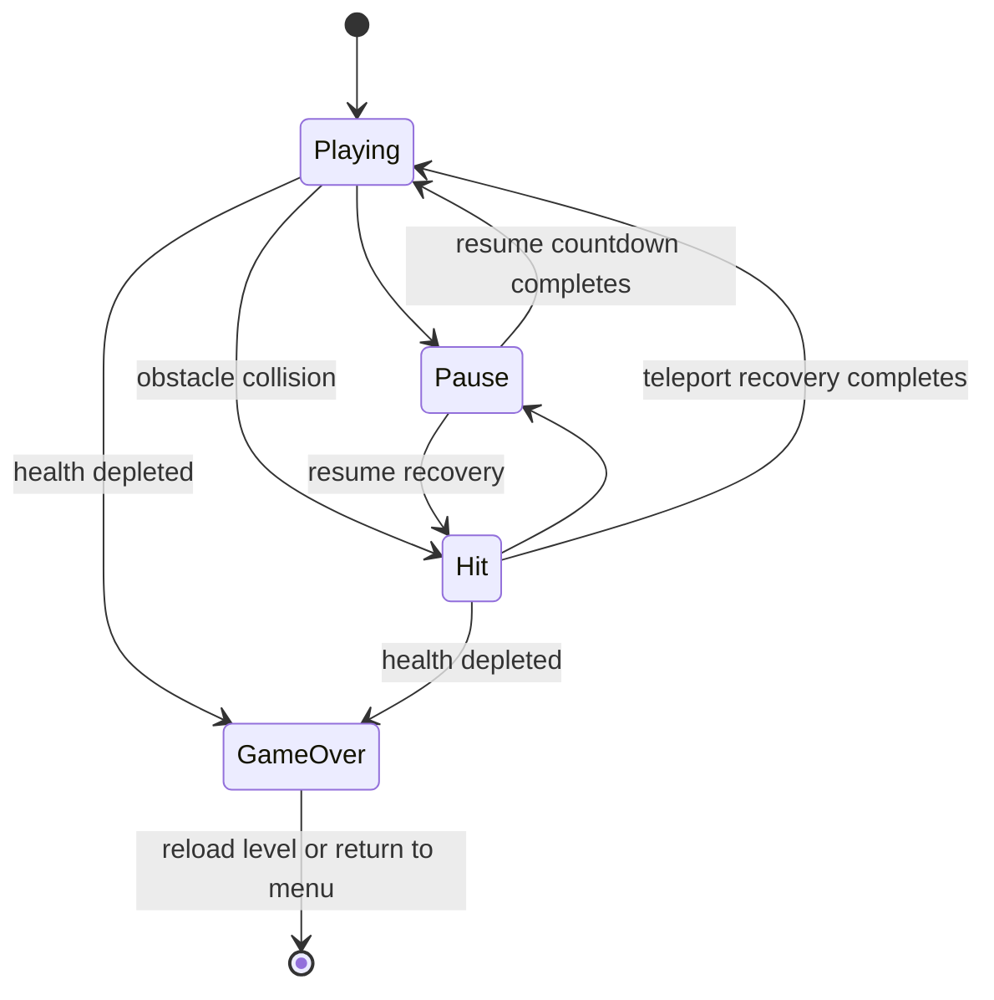

# CyberBiker architecture

The refactor keeps the serialized Unity controller components as composition roots. Their existing prefab IDs, inspector settings, animation event names and UI callback methods remain usable. Domain rules are ordinary C# objects; Unity components adapt physics, animation, input and scene lifetime to those rules.

## Responsibilities

| Type | Owns | Collaborates with |
|---|---|---|
| PlayerController | Player composition, collision/recovery orchestration | Health, BikeMotor, BikePresentation, IPlayerInput, Weapon |
| Health | Current/maximum health, damage/healing invariants | Changed and Died subscribers |
| IDamageable | Shared target contract | PlayerController, Enemy, Car, Bullet |
| Weapon | Fire interval and successful-shot event | ShotRequest, derived firing implementation |
| ProjectileWeapon | Projectile instantiation and ownership | Bullet |
| BikeMotor | Rigidbody movement and velocity limits | Input supplied by controller |
| BikePresentation | Steering pose, lean and aim animation | Animator and RigBuilder |
| TouchInputManager | Keyboard/mouse and touch command state | IPlayerInput |
| HealthPresenter | Health label and material cutoff | Health.Changed |
| RunSession | Run state, score, elapsed time, bounded history | StateChanged, ScoreChanged |
| GameplayManager | Scene UI wiring, pause/countdown, scene navigation | RunSession, ScorePresenter |
| DifficultyManager | Progression through configured traffic difficulties | Run state |
| WorldGenerator | Active road buffer and compatible tile placement | Biome, Tile, TrafficSpawner |
| Biome | Selection among compatible prefab candidates | Tile entry/exit surface |
| Tile | Lane references and exit socket | Street, HighStreet, Roof connection types |
| TrafficSpawner | Traffic waves, enemy spawning, car lifetime | AIController, DifficultyManager |
| Pickup | Single-consumption trigger lifecycle | Derived effect |
| Collectible | Original collectible effect | Player pickup particles |

## OOP evidence

- Encapsulation: Health and RunSession expose state through properties. Mutations occur through commands that preserve health bounds and prevent resurrection after GameOver.
- Interfaces: IDamageable lets a projectile affect player, enemy or car without concrete target casts. IPlayerInput supplies steering and aiming to the player.
- Inheritance and abstraction: Weapon declares an abstract Fire operation. ProjectileWeapon overrides it. Pickup declares an abstract Apply operation; Collectible overrides it.
- Polymorphism: PlayerController stores its weapon as Weapon and its input as IPlayerInput. Bullet dispatches damage through IDamageable. Pickup invokes the derived effect from its shared collision lifecycle.
- Overloading: Health.TakeDamage(float) and Health.TakeDamage(DamageInfo); Biome.GetRandomTile() and GetRandomTile(Tile). The structured forms preserve context while convenience forms support callers without it.
- Data structures in method arguments and returns: DamageInfo and ShotRequest carry related arguments. RunSession.GetSample returns a RunSample value.
- Custom structure array with dynamic data: RunSession owns a bounded RunSample[] circular history. Every playing tick records elapsed time, score and speed; GetSample exposes chronological values without exposing the writable array.
- Events and delegates: Health.Changed/Died, Weapon.Fired and RunSession.StateChanged/ScoreChanged use Action delegates. Presenters and gameplay listeners subscribe and unsubscribe over their lifetimes.
- Composition: Player behavior combines motor, presentation, input, health and weapons instead of inheriting a large entity hierarchy.

## Run lifecycle

The session remains paused for the entire resume countdown. Scoring and difficulty progression stop outside Playing. Delayed teleport recovery cannot transition GameOver back into Playing. Reloading creates a new session.

## City module integration

Tile entry and exit types default to Street so existing prefabs remain compatible. New city prefabs must explicitly declare Street, HighStreet or Roof and provide an exit socket at the actual length and elevation. Biome keeps the legacy first compatible tile by default; random variation is an explicit inspector option. It filters by entry compatibility; WorldGenerator uses the preceding exit position instead of assuming 100 m spacing. The legacy final-child socket fallback supports old prefabs.

This establishes the connection contract. Blender export, material baking, city prefabs, obstacle colliders, jump physics and mobile profiling are separate work; metadata alone does not make the Blender city playable. The current road-following traffic and player controllers still assume a generally forward route, so arbitrary intersection turns require additional movement design.

## Verification

`ArchitectureChecks.Run` is an editor check callable through CyberBiker > Verify architecture or Unity's `-executeMethod` argument. It checks health bounds and death events, abstract weapon dispatch and cooldown, frozen pause scoring, ordered circular history, terminal GameOver and missing scripts in both entry scenes.

`GameplaySmokeCheck.Run` is an explicit batch-mode Play check. It exercises scene initialization, forward movement, health changes, score/history, pause/resume countdown and death/recovery protection. Run it in a disposable copy because it opens Level and exits the editor on completion. Results are written under Logs.

Use the project editor version recorded in ProjectSettings/ProjectVersion.txt. The assignment specifies 6000.3 LTS, while this checkout is already on 6000.6.0f1; version compliance requires a separate, tested migration decision.

The architecture notes explain the submitted code; they do not replace the assignment's requested external diagrams and presentation. Credit external assets and assistance, and ensure that each contributor can explain the implementation and meet the assignment's originality declaration.

## Preserved gameplay contracts

The existing Aim button uses SwitchAim(bool) as a toggle and passes false. This callback retains toggle semantics; SetAim(bool) provides explicit on/off commands for mouse input. Checks invoke the actual scene button, wait for animation-driven readiness, and verify automatic firing effects while steering.

TrafficSpawner maintains the scene-configured wave buffer and retries incomplete planning on subsequent frames. Road-only probes exclude traffic colliders. Waves are planned before instantiation so delayed road availability cannot leave partial waves or permanently shrink the forward buffer. The regression check records both filled slots and the visible traffic horizon.

Collectibles play their original pickup effect even at maximum health and do not heal the player. Car explosions retain their original parent transform.

## Inspector tuning

Select the PlayerController or Enemy component and expand Weapon Tuning. Shooting Damage controls damage per projectile; the bullet prefab damage is only a fallback for projectiles spawned without a weapon. Shot Interval / Shoot Interval is seconds between shots, not shots per second. The enemy retains its alternating two-arm firing sequence.

| Component | Inspector setting | Preserved value or behavior |
|---|---|---|
| PlayerController | Shot Interval | 0.45 seconds, about 2.2 shots/second |
| PlayerController | Shooting Damage | 15 per projectile; seven hits against 100 HP |
| Enemy | Shoot Interval | 0.5 seconds between alternating shots |
| Enemy | Shooting Damage | 10 per projectile |
| Enemy | Health | Existing prefab/scene value, default 100 |
| Car | Health | Existing prefab value; legacy 0 still uses 5 HP |
| Car | Destructible | Enabled; disable to ignore damage |
| Car | Explode On Death | Enabled; disable to hide the car on death without the effect |
| Car | Explosion | Existing particle prefab; visual effect, no area damage |
| Bullet prefab | Bullet Speed / Lifetime | Existing prefab values, unchanged |

Weapon damage changes apply to the next shot in Play mode. The player's interval updates the next eligible shot without recreating the weapon or resetting cooldown. The enemy reads its interval when scheduling each alternating-arm wait; an already scheduled wait finishes at its original duration. Damage and destruction toggles can be tuned live. Starting health applies to newly spawned cars/enemies rather than resetting a damaged actor mid-run.

Play mode edits are temporary. Edit the corresponding prefab outside Play mode to keep tuning for future runs. TrafficSpawner uses the car prefabs assigned to WorldGenerator.

## Downloaded gameplay audio

Assets/Resources/CyberBikerAudio.prefab is the editable mix preset. GameplayManager creates one scene-scoped audio rig from it. It contains downloaded V12 engine, wind, pass-by, weapon, impact, explosion and interface clips. Source URLs, authors, modifications and licenses are in Assets/Audio/CyberBiker/CREDITS.md and sources.json. No synthesized sound assets are shipped.

Player pistol shots briefly lower the engine and wind by 6 dB for 55ms, with a smooth 160ms recovery, so the initial crack stands out over riding noise. The audio prefab exposes Pistol Duck Db, Pistol Duck Hold and Pistol Duck Release; zero dB disables this mix effect. Enemy shots, jacket flutter and other effects do not trigger or receive this reduction. Background speed response and base volume smoothing continue during the brief dip. Player-shot voices have priority 48; other pooled effects reset to 80 when reused.

GameAudio subscribes to SoundEvents and the existing run/health events. SoundEvent is a value structure carrying a cue and world position. Projectile creation, actual hits, destruction, collectibles and Aim clicks broadcast cues; audio does not modify their gameplay logic. A separate System.Random chooses audio variations so audio never consumes the gameplay random stream.

Engine pitch and engine/wind volume follow the bike's actual speed. Nearby cars crossing the rider trigger spatial whooshes and a short camera shake based on crossing distance and relative speed. The shake decays using game time and is suppressed in Aim mode so camera-based shooting stays stable. Effects use a bounded voice pool; car pass-by voices follow the car while playing. Gameplay loops and effects suspend during pause and resume after the countdown; interface cues remain available. The audio rig is destroyed with the scene and unsubscribes its observers.

Tune Master, Engine, Wind, Traffic, Pass Whoosh, Weapon, Impact, Explosion and Interface volumes in the prefab outside Play mode to save changes. The runtime CyberBiker Audio clone exposes the same sliders for temporary live tuning. Replace clip references directly in that prefab. Reference Speed controls the speed-to-revs mix; Pass By Distance controls which nearby traffic is audible.

### Recorded engine and wind

The engine uses a recorded V12 rev for the start of a run and crossfades over 2.5 seconds to a separately recorded sustained V12 section for riding. The equal-power blend ends just before the launch recording’s own fade-out. The cruise layer loops, with pitch and volume following smoothed bike speed; the launch does not repeat and there are no simulated gear changes at a fixed interval. These are car-engine recordings chosen for their character, not recordings of this motorcycle. The mono engine sources follow the bike in 3D relative to the chase-camera listener, with adjustable spatial blend and short source-local reverb. A separate listener-relative stereo field recording provides speed-scaled wind, with subtle steering-dependent panning and intensity; a low-pass filter opens with speed. Nearby car crossings trigger directional whooshes with their own adjustable reverb, plus a configurable brief camera jolt. The closest qualifying crossing in each scan takes priority, and the whoosh cooldown is independent of the separate traffic sound.

Reference Speed defaults to the bike's 75-unit speed cap. The audio speed responds gradually to arcade acceleration; this affects sound only, not physics or player controls. Adjust the sound clips, speed response, cruise pitch, volumes, engine spatial blend and reverb amount, low- and high-speed wind filter cutoffs, and pass-whoosh volume and reverb in the audio prefab. The camera component exposes pass-shake intensity, duration and frequency. Source credits and licenses are in the audio directory.

### Speed camera vibration

CameraController blends subtle smooth positional vibration and rotation into the chase view using the bike Rigidbody horizontal speed. It builds from 25 to 75 speed units by default, smooths acceleration and deceleration, and uses game time so pause freezes it. It is reduced in the air and suppressed during Aim to preserve the projectile ray. Speed thresholds, positional and rotational strength, and frequency are editable on Main Camera. Setting both strengths to zero disables the effect. It blends with the independent close-pass roll.

### High-speed wind mix

Wind uses two recorded stereo high-speed car-window airflow excerpts. A lower roar follows speed pressure, while a brighter rush grows and pans with steering. Wind volume controls both, and Wind Rush Volume and Steering Wind Boost set the added exposure. The base reserves headroom so steering remains audible at a Wind value of 1. Both loops and mix smoothing freeze on pause. Source and modifications are documented in the audio credits.

### Jacket fabric audio

GameAudio owns a mono fabric-flutter loop parented to the player’s animated jacket_01_03 hem bone (with the Jacket object as fallback). LateUpdate reads the bone’s angular motion after animation, smoothly combines it with bike speed and steering, and controls level and pitch. Jacket Volume, Jacket Steering Boost and Jacket Motion Reference are editable on the audio prefab. The layer pauses with the run, fades out when riding ends, and is cleaned up with the audio owner despite being parented outside that rig.

### Tire tread motion

MotoTiers uses CyberBiker/Stationary Lighting Tire, an independent built-in-pipeline shader with no Curved World dependency. It masks the eight tread atlas strips for the existing Motorcycle mesh, smooths their baked tread detail into a fixed shading layer and adds an antialiased moving groove pattern. Sidewalls/rims retain original UV sampling. At rest the original texture is shown; the moving layer blends in over the first two speed units. TireTreadMotion on both Player_Last prefabs advances a per-material property block from forward Rigidbody speed, with tunable wheel radius, visual spin scale and shutter blur. Game pause and non-playing states freeze the phase. Repacking the motorcycle UV atlas requires updating the tread bounds in the shader. TireVisualChecks.Render captures reference/animated images under Logs/Tire in the validation project.

The tread uses broader high-contrast bands to keep motion visible from the chase camera. Max Tread Band Rate limits apparent band passage to 18 per second, further bounded by frame rate, to avoid high-speed strobing. Tread Groove Contrast is editable on MotoTiers. The blur response retains most groove contrast at high speed.

### Steering tire contact effects

TireContactParticles reuses the Smoke particle child of the project's active Cartoon FX Remaster Explosion Smoke 2 Solo (HDR) asset, keeping its smoke atlas, material, flipbook and dissolve data. It combines these larger cartoon billows with a connected, ground-aligned TrailRenderer core so the result reads as a continuous trail from the contact patch. Smoke particles interpolate their spawn positions across the wheel's frame-to-frame travel. The core reuses the same Cartoon FX atlas in a simple outlined alpha-blended ribbon material. Small warm skid sparks remain separate. Ground rays exclude the rider and triggers; no contact or stationary wheels stop emission, pause freezes the effect, and seeded randomness does not affect gameplay. Each wheel is capped at 256 smoke particles plus 32 sparks. The continuous core lasts 0.055 seconds and grows with steering, while front-wheel output is reduced. The original explosion asset is unchanged.
